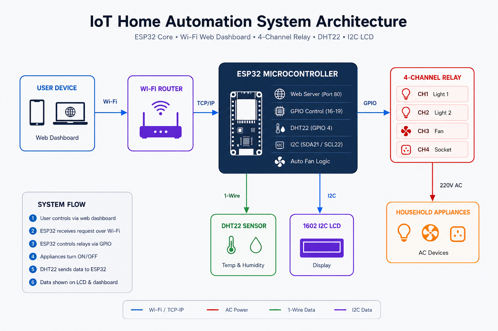

# IoT Based Home Automation System

A self-hosted home automation system built around the **ESP32**. Controls four household appliances through a web dashboard served directly from the ESP32 — no cloud service, no third-party app, no subscription. A **DHT22** sensor automatically switches a fan based on live temperature, and a **1602 I2C LCD** shows live status on the device itself.

Built as a Year I / Semester II project for the Department of Computer Science and Engineering, Kathmandu University.



## Features

- 🔌 **Remote appliance control** — toggle 2 lights, a fan, and a socket from any phone or PC on the same Wi-Fi network
- 🌡️ **Automatic fan control** — DHT22 temperature/humidity readings drive a configurable auto-fan threshold
- 🖥️ **Self-hosted web dashboard** — plain HTML/CSS served directly from the ESP32, no app or account required
- 📟 **On-device LCD feedback** — rotates between sensor readings and relay status
- 🔒 **Fully local** — everything runs over the home Wi-Fi network with no cloud dependency

## Hardware

| Component | Notes |
|---|---|
| ESP32 Dev Board | Dual-core, 240MHz, Wi-Fi + Bluetooth |
| 4-Channel Relay Module | 5V coil, 10A/250V AC per channel, active-LOW |
| DHT22 Sensor | Temperature ±0.5°C, Humidity ±2-5% |
| 1602 LCD + I2C (HW-061) backpack | Status display |
| 5V/2A Power Supply | Powers ESP32 + relay coils |

### Pin Map

| Signal | GPIO |
|---|---|
| Relay 1 — Bulb | 16 |
| Relay 2 — Socket | 17 |
| Relay 3 — Fan (auto) | 18 |
| Relay 4 — Multi-plug | 19 |
| DHT22 data | 4 |
| I2C SDA (LCD) | 21 |
| I2C SCL (LCD) | 22 |

## Documentation

- 📄 [Full Project Report](docs/IoT_Home_Automation_Report.pdf) — background, methodology, testing, ER diagram, budget, and references
- - 📊 [Defense Presentation](docs/IoT_Home_Automation_Presentation_final-defence.pptx)
- 🖼️ [System Architecture Diagram](docs/System-Architecture.png)

## Getting Started

1. Install the Arduino IDE and add the [ESP32 board package](https://docs.espressif.com/projects/arduino-esp32/en/latest/).
2. Install libraries: `WiFi`, `WebServer`, `DHT sensor library` (Adafruit), `Wire`, `LiquidCrystal_I2C`.
3. Open [`firmware/home_automation.ino`](firmware/home_automation.ino) and set your Wi-Fi credentials:
   ```cpp
   const char* WIFI_SSID     = "YOUR_WIFI_NAME";
   const char* WIFI_PASSWORD = "YOUR_WIFI_PASSWORD";
   ```
4. Wire the hardware per the pin map above.
5. Flash the board, open the Serial Monitor at 115200 baud to find the assigned IP address.
6. Open that IP in any browser on the same network.

## System Architecture

The ESP32 sits at the center, bridging the user's browser, the relay-controlled appliances, and the DHT22 sensor — all over the home Wi-Fi network, with no cloud involved. See [`docs/System-Architecture.png`](docs/System-Architecture.png) for the full diagram.

## Project Team

Nishant Sah · Sandesh Shrestha · Dipra Shrestha · Samin Tharu · Grishma Thapa
Kathmandu University, Department of Computer Science and Engineering
Supervisor: Mr. Santosh Shaha

## License

MIT — see [LICENSE](LICENSE).
